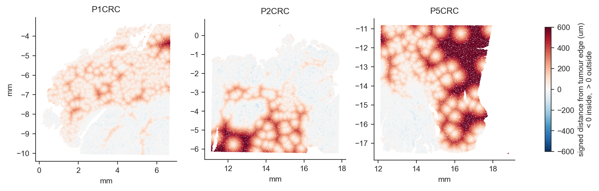
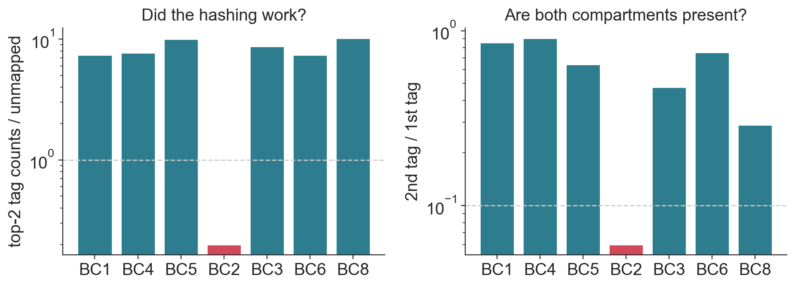

# End-to-end analysis notebooks — Jian Cui

Two worked analyses, each going from public archives through to the comparison,
with the reasoning behind the choices written down rather than left in the code.

| | Notebook | Modality | Data | Status |
|---|---|---|---|---|
| **01** | [`er_breast_immune_scrnaseq.ipynb`](01_singlecell_er_breast/er_breast_immune_scrnaseq.ipynb) | scRNA-seq + cell hashing | GEO [GSE193911](https://www.ncbi.nlm.nih.gov/geo/query/acc.cgi?acc=GSE193911) | complete |
| **02** | [`crc_border_transition.ipynb`](02_spatial_crc_visiumhd/crc_border_transition.ipynb) | Visium HD spatial | GEO [GSE280318](https://www.ncbi.nlm.nih.gov/geo/query/acc.cgi?acc=GSE280318) | complete |

Public data only.

<p align="center">
  <br>
  <em>Signed distance from the tumour boundary across three Visium HD sections —
  negative inside the tumour, positive in the stroma.</em>
</p>

---

## 01 — ER+ breast cancer, IDC vs ILC

- **Data:** GSE193911, from Onkar, Cui, Zou *et al.*, *Nature Cancer* 2023. I was
  the computational author on that paper; this is a re-analysis of the public
  data, not a reproduction of its figures.
- **Samples:** 11 patients — 6 hashed (PBMC + TIL on one lane) and 5 separate
  libraries. Tumour arm is 5 IDC vs 6 ILC. 25,500 cells after QC.
- **Runtime:** ~3 min, ~35 MB download.

What it covers:

- recovering the blood/tumour label from a separate hashtag matrix, including
  the barcode-suffix mismatch between the two GEO samples
- finding a failed sample from its hashing statistics and dropping it
- assigning an arbitrary tag number to a compartment using expression rather
  than assumption
- two CellRanger reference builds in one series, and joining on Ensembl IDs so
  a third of the genes are not lost silently
- combining hashed and non-hashed libraries without confounding the design
- integrating on patient while keeping the compartment axis, and reading the
  result where it only partly works
- composition and differential expression at the patient level
- reporting a large, correctly-directed subtype effect as not significant at
  this sample size

Six **Decision** points mark where a different choice changes the result.

**Running it**

```bash
cd 01_singlecell_er_breast
bash 00_download_data.sh
conda env create -f environment.yml
conda activate sc-demo
jupyter lab er_breast_immune_scrnaseq.ipynb
```

Plots are plain matplotlib; seaborn is only used for styling. The notebook does
not break on seaborn/pandas version changes.

<p align="center">
  <br>
  <em>Hashing quality per patient. BC2 fails both checks and is dropped.</em>
</p>

---

## 02 — Immune organisation around the tumour boundary, colorectal cancer

- **Data:** GSE280318, Oliveira, Romero, Chung *et al.*, *Nature Genetics* 2025.
  Visium HD, 8 µm bins.
- **Samples:** the three tumour sections, ~500,000 in-tissue bins each.
- **Runtime:** ~40 s, ~150 MB download.

What it covers:

- calibrating the coordinate scale from the bin lattice instead of assuming it,
  which also shows the three sections were exported on slightly different scales
- a **signed** distance to the tumour boundary, so the tumour interior is part
  of the axis rather than collapsed to zero
- validating that distance against the authors' own `Periphery` annotation
  before building anything on it
- normalising composition within section and distance bin before pooling, so
  the largest section does not set the shape of the curve
- reporting gradients by direction and cross-section replication rather than by
  a p-value over half a million non-independent bins
- applying the same axis to expression

Five **Decision** points.

**Running it**

```bash
cd 02_spatial_crc_visiumhd
bash 00_download_data.sh
conda env create -f environment.yml
conda activate spatial-demo
jupyter lab crc_border_transition.ipynb
```

---

## Contact

**Jian Cui** — Senior Bioinformatics Scientist
Vignali Lab, Department of Immunology
School of Medicine, University of Pittsburgh
<cuij@pitt.edu>
